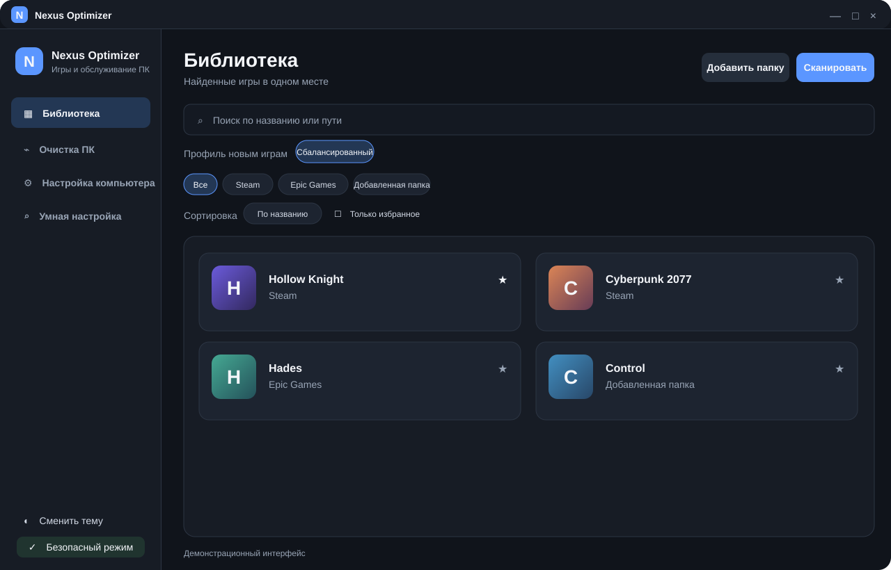
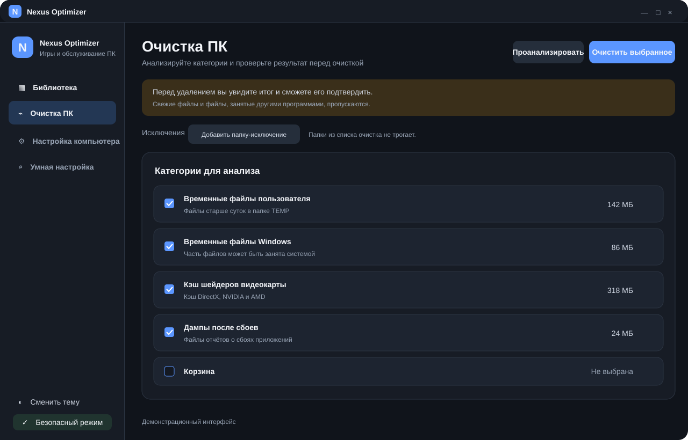
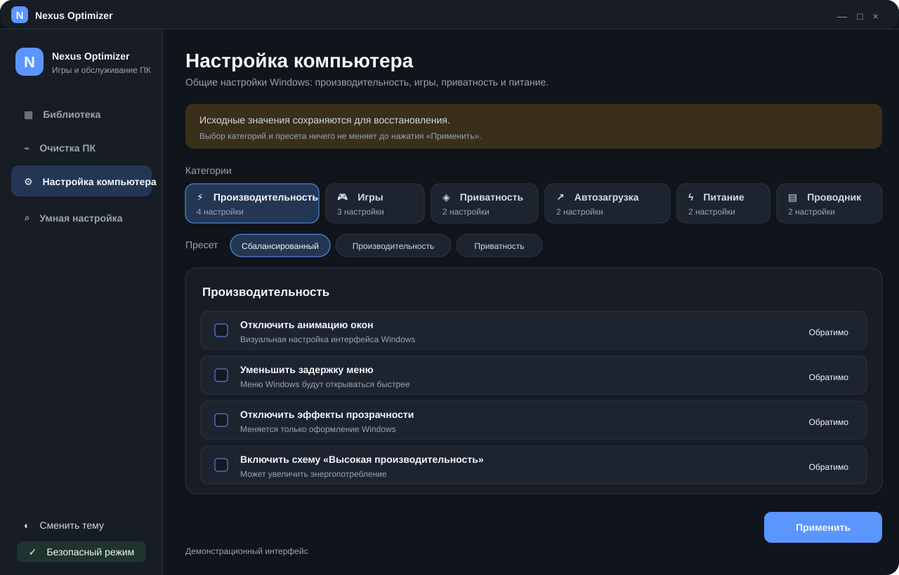

# Nexus Optimizer

**Игровая библиотека и инструменты для настройки Windows — с понятными действиями и без автоматических изменений системы.**

[Скачать последнюю версию](https://github.com/xen9973/NexusOptimizer/releases/latest) · [Исходный код](https://github.com/xen9973/NexusOptimizer)

## Интерфейс

Иллюстрации демонстрируют основные разделы приложения:







## Возможности

- **Библиотека игр** — поиск игр Steam и Epic Games, а также игр в выбранных папках. Есть поиск, фильтры, сортировка, избранное и профили настроек.
- **Очистка ПК** — анализ временных файлов и кэшей перед удалением. Свежие и занятые файлы пропускаются; доступны папки-исключения и журнал очистки.
- **Настройка компьютера** — управление настройками Windows по категориям. Для поддерживаемых изменений сохраняются исходные значения, чтобы их можно было восстановить.
- **Умная настройка** — просмотр характеристик ПК и рекомендаций. Сканирование само по себе ничего не меняет.
- **Поиск драйверов** — проверка доступных обновлений через Windows Update; установка остаётся под вашим контролем.
- **Светлая и тёмная темы**.

## Безопасность

Вы сами выбираете, какие настройки применять. Перед очисткой можно проверить список файлов, а перед изменением Windows — посмотреть выбранные параметры. Некоторые системные настройки требуют прав администратора или перезагрузки.

Результат настроек зависит от компьютера и Windows. Программа не обещает универсальный прирост FPS и не отключает защитные функции Windows.

## Скачать

Откройте [страницу последнего релиза](https://github.com/xen9973/NexusOptimizer/releases/latest) и скачайте `NexusOptimizer.exe`. Для сборок релиза не требуется отдельно устанавливать .NET Runtime.

## Запуск из исходного кода

**Требования:** Windows и .NET 9 SDK.

```powershell
git clone https://github.com/xen9973/NexusOptimizer.git
cd NexusOptimizer
dotnet run --project NexusOptimizer/NexusOptimizer.csproj
```

Запустить тесты:

```powershell
dotnet test NexusOptimizer.slnx
```

## Технологии

C#, .NET 9, WPF.
